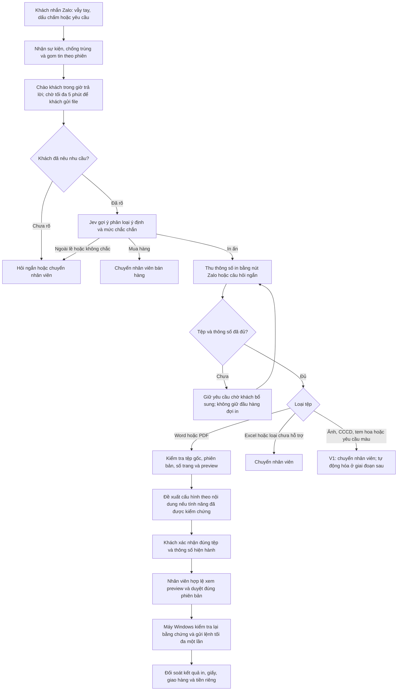

# Quy trình AUTO-IN theo sơ đồ hoạt động của chủ cửa hàng

**Ngày ghi nhận:** 21/10/2026  
**Nguồn:** `Biểu đồ không có tiêu đề.drawio` do chủ cửa hàng cung cấp, SHA-256 `858e058fc48db91df838f98ed705516c5fcf48f33f640ef577112415dd65b25a`.  
**Tham chiếu Jev:** [TypeSafe AI — Introducing System One Models & Jev](https://typesafe.ai/blog/introducing-system-one-models-and-jev).  
**Tình trạng:** Quy trình đích và ranh giới triển khai. Tài liệu này ghi nhận yêu cầu mới; các quy tắc TN-001–TN-037 đã chốt vẫn là cổng nghiệp vụ cho V1. Nó không phải bằng chứng tính năng đã được triển khai hoặc kiểm thử thật.

## 1. Luồng hoạt động

### Tiếp nhận và phân loại

1. Tin nhắn mở đầu như “vẫy tay” hoặc dấu chấm được ghi nhận để nhân viên dễ thấy; bot chào khách trong khung giờ có hiệu lực. Sau lời chào, hệ thống có thể chờ **tối đa 5 phút để khách gửi file**. Khoảng chờ này tách khỏi quy tắc gom tin hiện có: tối đa 60 giây sau tin đầu và khoảng 10 giây cho tin tiếp theo (TN-001). Khách chưa gửi file ở mốc 5 phút giữ trạng thái chờ bổ sung; không chặn đơn khác.
2. Jev được đặt ở bước **phân loại/lọc dữ liệu và định tuyến**, không cấp quyền xác nhận, duyệt hay in. Các nhãn cần có: `IN_AN`, `MUA_HANG`, `DICH_VU_KHAC`, `KHONG_RO`. Kết quả không chắc chắn hoặc lỗi API dẫn tới câu hỏi ngắn hoặc hàng chờ nhân viên.
3. Bài giới thiệu của TypeSafe mô tả Jev trả quyết định có cấu trúc cùng xác suất/độ tin cậy, phù hợp với phân loại và định tuyến. Jev không sinh câu trả lời hội thoại tự do. Thành phần trả lời khách, nếu dùng, phải tách khỏi quyết định phân loại; quy tắc cố định và xử lý thủ công vẫn hoạt động khi Jev lỗi. Bài blog chưa đủ để xác nhận endpoint, điều kiện truy cập, giới hạn hoặc khả năng đọc trực tiếp ảnh/PDF; chỉ thiết kế tích hợp sau khi có tài liệu API và thử nghiệm riêng.
4. Nhánh mua hàng chuyển người phụ trách. Câu hỏi ngoài lề, ý định mơ hồ hoặc nhân viên đã tiếp quản cũng chuyển người; bot ngừng tự trả lời trong đúng hội thoại đã tiếp quản.

### Nhánh in Word/PDF của V1

5. Hỏi khách các trường còn thiếu qua nút Zalo nếu tính năng nút/callback đã được xác minh, kèm cách trả lời bằng chữ khi không dùng được nút: **một/hai mặt, số bản, đen trắng/màu, khổ giấy, yêu cầu đặc biệt**. Không suy ra số trang từ AI; lấy từ quá trình xử lý tệp và preview.
6. PDF/Word đủ điều kiện đi qua đường xử lý của chính định dạng gốc. Excel, tệp lỗi/không hỗ trợ, trên 5 tài liệu thực, yêu cầu màu, ảnh, CCCD và tem hoa chuyển nhân viên trong V1 theo phạm vi Word/PDF hiện hành.
7. Với bài tập/bài làm, sơ đồ của chủ gợi ý **A4, hai mặt, một bản**. Với hợp đồng/hành chính, hỏi một hay hai mặt và số bản. Với giấy tờ đi nước ngoài, gợi ý một mặt rồi hỏi số bản. Đây là **gợi ý để khách xác nhận**, không phải lệnh in mặc định. Nội dung khác hoặc phân loại thiếu chắc chắn phải hỏi lại. Nếu về sau dùng Jev để nhận diện loại văn bản, chỉ đưa văn bản/metadata đã trích xuất phù hợp vào bộ phân loại; kiểm chứng riêng đường trích xuất, quyền truy cập và độ chính xác.
8. Khi đủ tệp và thông số, tạo preview và bản tóm tắt gắn với phiên bản/tệp hiện hành. Khách xác nhận trước; nhân viên hợp lệ duyệt sau khi xem đúng phiên bản và cảnh báo. Thay tệp, số bản, mặt in, màu, khổ hoặc preview làm xác nhận/duyệt cũ hết hiệu lực. Agent Windows kiểm tra lại evidence trước khi gửi tối đa một lần. Kết quả mơ hồ giữ `UNKNOWN` và chờ người đối soát; không tự gửi lại.
9. Sơ đồ đề cập nhân viên duyệt trên điện thoại hoặc nhập mã nhanh “trong vòng 1 tiếng”. Ghi nhận đây là **đề xuất thời hạn hiệu lực của mã/phiên duyệt**, chưa coi 1 tiếng là thời hạn tự động in. Mã hết hạn hoặc chưa có duyệt hợp lệ thì không tạo quyền in. Cần chốt cách cấp, nhập, hết hạn và thu hồi mã trước khi xây dựng.

### Nhánh ảnh và dịch vụ mở rộng

10. Sơ đồ nêu ba nhánh ảnh: ảnh chụp văn bản, ảnh giấy tờ tùy thân/CCCD và ảnh có chữ để tạo tem hoa. Trong V1, tất cả được tiếp nhận và chuyển nhân viên; việc nhận diện, sửa ảnh và tạo bản in tự động thuộc giai đoạn sau.
11. Giai đoạn sau, ảnh chụp văn bản có thể được chỉnh nghiêng, sáng và nét nhưng phải giữ đủ nội dung. Sơ đồ đề xuất lề 1 cm và in đen trắng; preview cần nhân viên/khách kiểm tra trước khi dùng. Với tem hoa, trích chữ để điền vào mẫu đã chọn, sau đó người có quyền kiểm tra nội dung và bố cục.
12. Với CCCD, sơ đồ ghi cách nhận biết mặt trước/sau, đặt hai mặt cách nhau 1 cm và kích thước **100 × 70 mm**. Con số và cách bố trí này mới là thông tin trong sơ đồ, **chưa được chốt làm thông số in tự động**; cần kiểm tra mẫu giấy tờ, kích thước thực, yêu cầu của khách và bản in thử trước khi triển khai.

### Dữ liệu khách hàng và quảng cáo

13. Sơ đồ mong lưu thông tin để hiểu nhu cầu và gợi ý sản phẩm sau này. Tách dữ liệu phục vụ đơn hàng khỏi hồ sơ tiếp thị. Chỉ lưu trường cần thiết, có quyền truy cập và cơ chế khách đồng ý/không đồng ý cho tiếp thị; không dùng toàn bộ nội dung tin nhắn hoặc tài liệu khách làm bộ nhớ quảng cáo mặc định. Quy tắc xóa tài liệu gốc, preview và dữ liệu xử lý theo TN-011 vẫn áp dụng. Chức năng phân tích/quảng cáo tự động là việc mở rộng, có phạm vi và nghiệm thu riêng.

## 2. Ranh giới phát hành

| Nội dung từ sơ đồ | V1 ra sớm | Giai đoạn sau |
| --- | --- | --- |
| Chào, nhận/gom tin, chờ file 5 phút | Có thể áp dụng bằng quy tắc thời gian rõ và thử bằng đồng hồ giả | Tối ưu thêm theo dữ liệu thật |
| Jev lọc ý định/loại dịch vụ | Đường tích hợp tùy chọn; lỗi hoặc thiếu quyền API vẫn xử lý bằng quy tắc và nhân viên | Thử và đo chất lượng Jev trên dữ liệu đã được phép dùng |
| Nút chọn thông số qua Zalo | Dùng sau khi callback/nút thật được xác minh; luôn có cách hỏi bằng chữ | Mở rộng bộ câu hỏi theo từng dịch vụ |
| Word/PDF và gợi ý thông số | Giữ luồng preflight, khách xác nhận, nhân viên duyệt, agent in an toàn | Jev gợi ý loại nội dung từ văn bản đã trích xuất |
| Ảnh, CCCD, tem hoa, màu, Excel | Tiếp nhận và chuyển nhân viên | Nhận diện, chỉnh ảnh, dàn trang và tự động hóa từng loại sau kiểm thử |
| Duyệt bằng mã nhanh, thời hạn 1 giờ | Chưa dùng để tự cấp quyền; duyệt theo quyền hiện hành | Thiết kế mã một lần, hết hạn và kiểm toán sau khi chủ chốt |
| Lưu dữ liệu cho quảng cáo | Giữ dữ liệu đơn theo chính sách hiện hành | Hồ sơ tiếp thị có lựa chọn đồng ý và thời hạn riêng |

## 3. Điều kiện để chuyển thành việc lập trình

- **AI0/AI2:** xác minh quyền và hợp đồng API của Jev cùng nút/callback Zalo; chốt kiểu dữ liệu đầu vào/đầu ra, nhãn phân loại, ngưỡng không chắc chắn, timeout, chi phí và đường chuyển nhân viên. Không gửi tệp khách lên Jev chỉ vì sơ đồ có nhánh nhận diện tệp.
- **AI1:** giữ quyền xác nhận và duyệt ở Core; không biến kết quả Jev thành quyền in. Đồng hồ chờ file không làm một đơn thiếu thông tin chặn hàng đợi.
- **AI3:** giữ nguyên đường Word/PDF V1; ảnh/CCCD/tem hoa chỉ mở từng phần khi có bộ dữ liệu thử, preview và đường xử lý được kiểm chứng.
- **AI4:** hiển thị lựa chọn thông số, trạng thái chờ file/chuyển người và lý do chưa thể in; không hiển thị “đã in” từ suy đoán của AI.
- **AI5:** kiểm thử phân loại sai/không chắc, timeout API, hết 5 phút không có file, callback lặp, thay tệp sau xác nhận, duyệt hết hạn và không in trùng. Tách PASS mô phỏng khỏi OA, Windows và máy in thật.

**Quyết định còn phải chốt trước khi triển khai các phần mới:** semantics của mốc chờ file 5 phút; cơ chế và thời hạn mã duyệt 1 giờ; kích thước/bố trí CCCD; dữ liệu nào được dùng cho tiếp thị và cách ghi nhận đồng ý. Những điểm này không ngăn việc tiếp tục V1 Word/PDF với cổng xác nhận và duyệt hiện hành.
