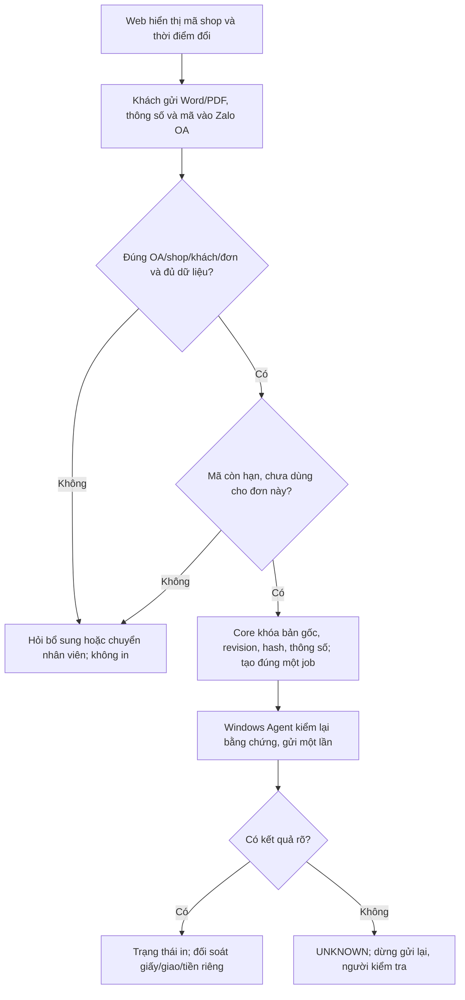

# AUTO-IN — V1 tối giản theo quyết định chủ cửa hàng 21/10/2026

Nguồn quy trình dài hạn: biểu đồ draw.io của chủ cửa hàng (SHA-256 `858e058fc48db91df838f98ed705516c5fcf48f33f640ef577112415dd65b25a`). Jev của TypeSafe AI chỉ là backlog lọc ý định sau V1. Tài liệu này ghi nhận phạm vi triển khai mới, không phải bằng chứng đã chạy. Các yêu cầu TN-001–TN-037 cũ vẫn là chuẩn của bản đầy đủ; chỗ khác với pilot phải được ghi rõ trong nghiệm thu.

## Mục tiêu bản đầu

Khách gửi **Word/PDF gốc**, đủ thông số in và **mã đang hiển thị tại cửa hàng** qua Zalo OA. Mã riêng mỗi shop đổi sau **30 phút**. Khi Core xác minh đúng OA, shop, khách, đơn, file, thông số và mã còn hạn, Windows Agent tự gửi **một** lệnh in đến máy in đúng cửa hàng. Web tối thiểu hiển thị mã hiện hành, lúc đổi mã và trạng thái đơn. Pilot không cần preview cho khách/nhân viên hoặc thao tác nhân viên duyệt trên máy trước mỗi đơn.

Mã cho biết khách biết mã ở cửa hàng; người khác có thể chia sẻ mã nên đây không phải bằng chứng vị trí tuyệt đối. Mã phải được tạo ở server, giới hạn thử sai, không ghi giá trị thô vào log, hết hạn đúng cửa sổ 30 phút và chỉ cấp quyền cho đúng đơn/phiên bản. Nếu khách gửi mã trước file, chỉ cấp quyền khi mọi dữ liệu đã đủ và mã vẫn còn hạn lúc đó.

Bản đầu ưu tiên **Word/PDF đen trắng trên A4 và máy/khổ đã kiểm chứng**; hỏi rõ số bản, một/hai mặt, khổ giấy và yêu cầu khác. Thiếu trường thì hỏi thêm. A3, màu, ảnh, CCCD, tem hoa, Excel, ZIP, file lỗi hoặc cấu hình chưa được kiểm chứng chuyển nhân viên/giai đoạn sau. Không phụ thuộc Jev, DeepSeek, OCR, nhận dạng nội dung, tự định giá hay quảng cáo để in Word/PDF.

Không tạo job chỉ vì thấy một tin chứa mã. Core kiểm file gốc/bytes và hash, thông số, revision, shop/printer, mã còn hạn và OA identity trong luồng có chống lặp. Agent ghi journal trước khi gửi, không tự resend khi ACK/driver mơ hồ; UNKNOWN cần người đối soát. File/thông số thay đổi hoặc mã mới không tự cho phép in lại job đã gửi. Lỗi Word/PDF/font/driver phải dừng an toàn, không in bản preview hoặc phiên bản cũ.

## Phần để sau

Preview, duyệt trên máy, Jev lọc ý định, ảnh/CCCD/tem hoa, màu, Excel, tính giá tự động, gợi ý theo nội dung và phân tích khách hàng đều thuộc backlog sau khi Word/PDF chạy thật. Việc bỏ preview/duyệt trong pilot khác TN-007/TN-034 và tài liệu 17/10; AI0 phải cập nhật ma trận thay đổi yêu cầu và điều kiện phát hành pilot, không xóa TN cũ hoặc báo TN-037 đầy đủ đã PASS.

## Chia việc song song

| AI | Việc bắt đầu ngay | Điểm ghép |
| --- | --- | --- |
| AI0 | Chốt wire mã/OA/job/source, tích hợp runtime thật và ma trận pilot | Base SHA, API/schema và thứ tự ghép |
| AI1 | Core tạo/kiểm mã theo shop, chống đoán/replay, khóa order/revision/settings, tạo đúng một job | Không giả staff approval; contract provenance mới |
| AI2 | OA thật nhận Word/PDF, text mã, xác minh webhook/tải file/chống trùng, hỏi thông số thiếu | OA→Core contract và tài khoản OA thử |
| AI3 | Windows in Word gốc bằng Word, PDF gốc, kiểm nguồn và journal/UNKNOWN | Source ticket từ AI0/AI1; host Windows |
| AI4 | Web hiển thị mã server cấp, thời điểm đổi, trạng thái đơn | API mã có phân quyền; không tạo mã tại browser |
| AI5 | Acceptance pilot: mã sai/hết hạn, duplicate, đổi file, Word/PDF, driver lỗi/UNKNOWN | Candidate tích hợp exact SHA |
| AI6 | Chuẩn bị test tích hợp OA→Core→Agent với file công khai và DB cô lập | Runtime/fixture tích hợp |
| AI7 | Review diff/candidate và hậu kiểm CI exact SHA, GO/NO-GO pilot | Handoff AI0; PASS cũ không chuyển sang SHA mới |

Trước khi phát hành: CI trên exact SHA; OA thật với tài khoản thử; Word/PDF công khai trên Windows/Ricoh và đối chiếu giấy có giám sát; kiểm không in trùng khi lỗi/UNKNOWN. DryRun không chứng minh giấy đã in. Không lưu tài liệu khách, mã thô hay credential vào Git/log.
